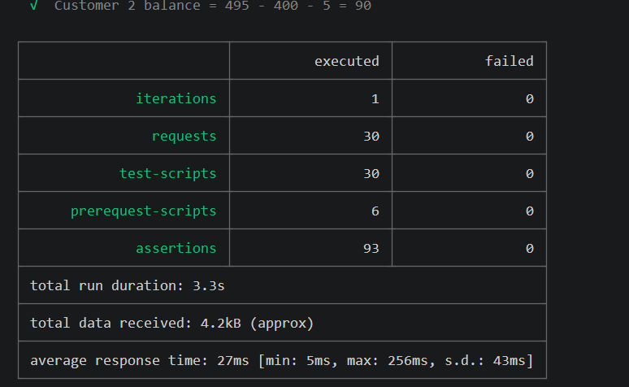
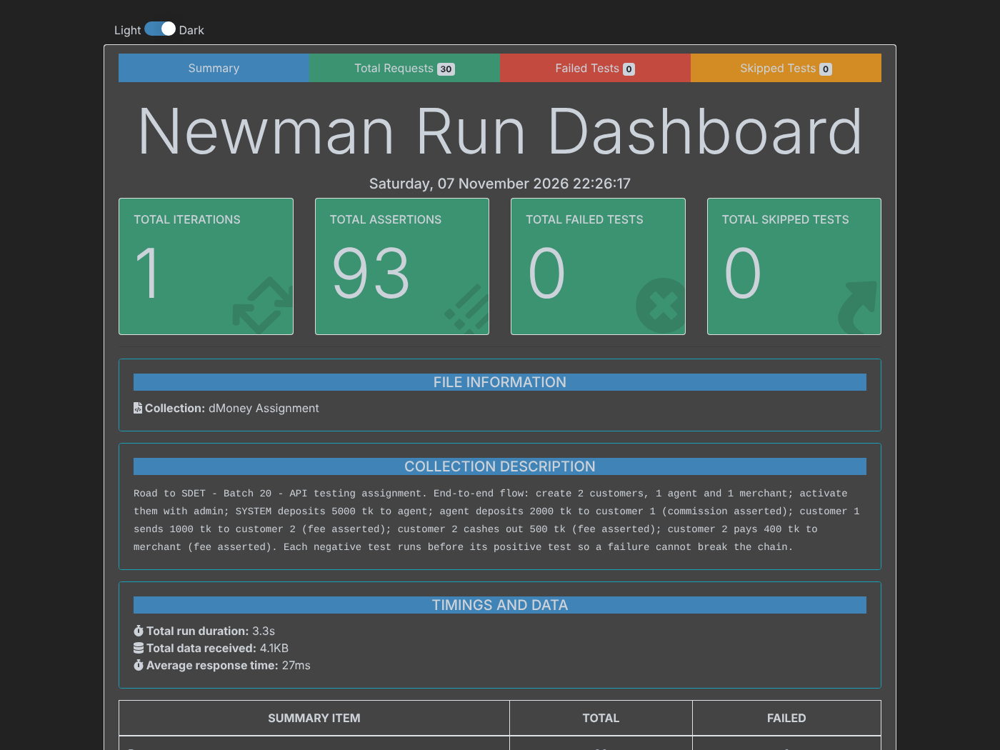

# dMoney API Testing — Postman & Newman

Road to SDET · Batch 20 · **Assignment on API Testing**

Integration testing of the dMoney mobile-banking API with Postman. The collection runs one end-to-end money flow and checks every step with assertions. Newman runs it from the command line and produces an HTML report.

## Links

| Item | Link |
|---|---|
| Test cases (30) | [docs/test-cases.md](docs/test-cases.md) |
| API documentation | [captainjigs.github.io/dmoney-api-testing](https://captainjigs.github.io/dmoney-api-testing/) |
| Postman collection | [dMoney-Assignment.postman_collection.json](dMoney-Assignment.postman_collection.json) |

## Scenario covered

1. Create 2 customers, 1 agent and 1 merchant with the admin API (random name, email, phone and NID)
2. Activate all 4 users with the admin API
3. SYSTEM account deposits **5000 tk** to the agent
4. Agent deposits **2000 tk** to Customer 1 — asserts **deposit commission**
5. Customer 1 sends **1000 tk** to Customer 2 — asserts **service fee**
6. Customer 2 cashes out **500 tk** from the agent — asserts **service fee**
7. Customer 2 pays **400 tk** to the merchant — asserts **service fee**

Each **negative** test runs **before** its positive test, so a failed negative case cannot break the chain. Negative cases use small amounts (5–10 tk) and are always rejected, so they do not count toward daily limits.

### Fee rules asserted

| Transaction | Rule | Amount | Expected |
|---|---|---|---|
| Agent deposit | 2.5% commission | 2000 | commission **50** |
| Send money | flat 5 tk | 1000 | fee **5** |
| Cash out | 1%, minimum 5 tk | 500 | fee **5** |
| Payment | 1%, minimum 5 tk | 400 | fee **5** (1% = 4, minimum applies) |

The tests also assert the balance after each transaction: agent 3050, Customer 1 995, Customer 2 495 → 90.

## Test summary

- **30 test cases** — 21 positive, 9 negative
- **93 assertions** — status code, message, role, token, fee, commission, balance

## Tech stack

Postman · JavaScript (Postman test scripts) · Newman · newman-reporter-htmlextra · Node.js

## Project structure

```
dmoney-api-testing/
├── dMoney-Assignment.postman_collection.json   # 30 test cases
├── docs/
│   ├── index.html          # API documentation
│   ├── test-cases.md       # test case list
│   └── images/             # report screenshots
├── package.json            # Newman scripts
├── .gitignore              # node_modules, Reports, .env, Postman local files
└── README.md
```

## How to run

**Prerequisites:** Node.js, and the dMoney backend running on `http://localhost:5000`.

```bash
git clone https://github.com/CaptainJigs/dmoney-api-testing.git
cd dmoney-api-testing
npm install
npm test
```

`npm test` runs the collection with Newman and saves the HTML report to `Reports/dmoney-report.html`.

**Note on OTP:** Customer, Agent and Merchant logins need an OTP. The collection uses the server's development bypass (`POST /user/verify-otp?env=dev` with `DEFAULT_OTP` from the server `.env`, default `0000`), so the whole flow runs without manual input. Change the `defaultOtp` collection variable if your server uses another value.

## Observations / Bugs found

Found while testing the API and reviewing the backend code.

| # | Area | Observation | Severity |
|---|---|---|---|
| 1 | `GET /transaction/balance/{account}` | `services/getBalance.js` builds the SQL query by string concatenation (`"... WHERE account='" + account + "'"`). The `account` value comes from the URL, so this is a **SQL injection risk**. It should use a parameterized query (`replacements`), as the deposit controller already does. | High |
| 2 | `PATCH /user/update/{id}` | The response returns only the fields sent in the request body (e.g. `{ "status": "active" }`), not the full updated user. A client cannot confirm the user's name, role or phone from the response. | Medium |
| 3 | API docs vs. behaviour | Swagger documents business-rule errors (minimum amount, role mismatch) as **208**, but the API returns **400** (see TC23, TC27, TC29). The documentation and the implementation do not match. | Low |
| 4 | `PUT`/`PATCH /user/update/{id}`, `DELETE /user/delete/{id}` (protected users) | Trying to update or delete the admin or SYSTEM account returns 403 with the message *"Stupid! Do not try to update this!"* (or *"...delete this!"*). The API response contains an unprofessional error message. | Low |

## Newman report





## Author

**Ishtiak Ahmed Jigor** · Road to SDET, Batch 20 · [GitHub @CaptainJigs](https://github.com/CaptainJigs)
